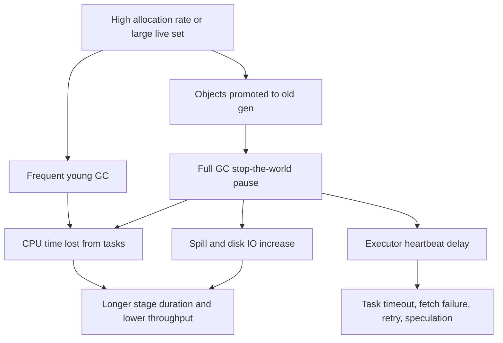

# 4.1.6 How does Garbage Collection (GC) affect Spark performance?

Garbage Collection affects Spark through stop-the-world pauses, CPU overhead, heap pressure, and failure/retry loops.

### Core effects

- Stop-the-world pauses block task threads, shuffle reads, and heartbeat threads. Executors can appear dead to the driver.
- GC CPU competes with task CPU. High GC time in Spark UI means less useful work per core.
- Heap pressure triggers eviction, spill, deserialization, and more allocation. This creates a GC and spill feedback loop.
- Long driver GC pauses delay DAG scheduling and stage progress.
- Long executor GC pauses cause task failures, fetch failures, retries, and speculative duplicate work.
- Large heap reduces GC frequency but increases pause length. Small heap increases GC frequency and OOM risk.
- Deserialized caching and object-heavy UDFs raise the live set and promotion rate. Serialized or off-heap storage lowers GC pressure.
- Tungsten and codegen reduce object churn, but UDFs and collect operations can bypass those benefits.

### GC symptom table

| Symptom | Spark effect | Action |
|---|---|---|
| High GC time in stage UI | Low CPU efficiency, long tasks | Reduce object churn, tune heap, check UDFs |
| Frequent full GC | Stop-the-world pauses, heartbeat timeouts | Reduce live set, use serialized cache, increase heap only if pause is acceptable |
| Executor heartbeat timeout | Task failure, retry, speculation | Fix GC pauses, reduce cores per executor, tune GC |
| Shuffle fetch failures | Stage retries | Check executor GC pauses and heap pressure |
| Increased spill | Disk IO, slower stages | Adjust memory fractions, partition size, caching |
| Driver GC pauses | Slow scheduling, stage delays | Reduce driver collect, broadcast, and metadata load |

### GC type table

| GC area | Behavior | Spark impact |
|---|---|---|
| Young GC | Frequent, short pauses | Fine if short. Frequent young GC means high allocation rate |
| Old or full GC | Long stop-the-world pauses | Severe. Causes task stalls, timeouts, retries |
| G1GC | Region based, pause target | Better for large heaps. Set MaxGCPauseMillis |
| Parallel GC | Throughput oriented, longer pauses | Can hurt latency-sensitive Spark stages |

### Tuning levers

- Set executor heap with headroom using `spark.executor.memory` and `spark.executor.memoryOverhead`.
- Use G1GC for large heaps with `-XX:+UseG1GC` and `-XX:MaxGCPauseMillis`.
- Reduce object churn with Dataset encoders, fewer UDFs, primitives, and less string concatenation.
- Cache serialized with `MEMORY_ONLY_SER` or `MEMORY_AND_DISK_SER`. Consider off-heap storage.
- Control live set. Do not cache oversized DataFrames. Unpersist unused data.
- Reduce cores per executor if GC pauses cause heartbeat or task timeouts.
- Tune `spark.memory.fraction` and `spark.memory.storageFraction` for the workload.
- Fix skew and huge partitions. Large partitions create large objects and GC spikes.
- Monitor GC time in Spark UI, executor GC logs, heap usage, and full GC count.
