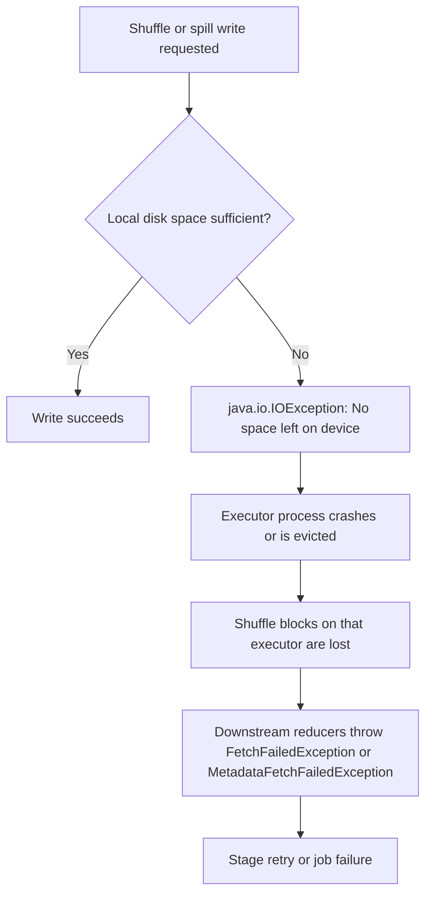

# 4.1.7 What happens when a node runs out of disk space during a shuffle?

When a node runs out of disk space during a shuffle, the executor cannot write its shuffle or spill files. This is a **fatal, non-recoverable condition for that executor**: it crashes, and downstream stages fail when they try to fetch the now-missing shuffle data.

### Failure Behavior

- The immediate trigger is usually a `java.io.IOException: No space left on device` in the executor logs, often during a shuffle write or spill operation.
- Because shuffle files are intermediate and not replicated, the loss of the executor means those blocks cannot be fetched.
- The error surfaced to the driver is typically `org.apache.spark.shuffle.FetchFailedException` or `org.apache.spark.shuffle.MetadataFetchFailedException`.
- On Kubernetes, the kubelet may preemptively evict the pod before Spark itself throws the disk error, especially if ephemeral-storage limits are enforced.
- The executor is marked as lost. Spark will retry the failed stage, but if the underlying disk pressure persists, the retry loop repeats until `spark.stage.maxConsecutiveAttempts` or the application failure threshold is reached.

### Root Causes

| Cause | Mechanism |
|---|---|
| Shuffle spill volume exceeds disk | Memory cannot hold the shuffle data, so it spills to `SPARK_LOCAL_DIRS`; if the combined shuffle and spill footprint is larger than the local disk, the write fails |
| Skewed partitions | One or a few reducers receive disproportionately large partitions, filling the disk of a single executor while others remain underused |
| Small or misconfigured disks | `SPARK_LOCAL_DIRS` points to a volume that is too small for the shuffle workload, or multiple disks have unequal free space and one fills first |
| Orphaned shuffle files | In long-running applications or dynamic allocation, shuffle files from lost or deallocated executors are not cleaned up promptly, causing gradual disk exhaustion |

### Impact on the Job

- **Stage retry**: The stage is rescheduled, but unless the disk pressure is relieved, the retry will fail again.
- **Cascading failures**: If multiple executors run out of disk, the job can enter a retry loop that eventually exhausts `spark.task.maxFailures` or the application attempt limit.
- **Data loss risk**: Shuffle data is not replicated. Lost shuffle blocks cannot be recovered from another node; the producing stage must be recomputed.
- **Cluster instability**: On Kubernetes or YARN, repeated executor evictions or container kills can trigger node-level pressure and affect other applications on the same host.

### Mitigation and Prevention

| Lever | Action |
|---|---|
| Reduce shuffle volume | Filter early and select only required columns before the shuffle |
| Increase partition count | Raise `spark.sql.shuffle.partitions` above the default 200 to reduce per-partition size and spill per executor |
| Handle skew | Enable AQE skew join handling with `spark.sql.adaptive.skewJoin.enabled`; skewed partitions are split at runtime |
| Enable shuffle compression | Keep `spark.shuffle.compress=true` (default) to reduce bytes written to disk |
| Size local disks correctly | Provide local storage sized to at least **2 to 3 times the largest input size** for heavy shuffle workloads; Databricks recommends a minimum of 100 GB |
| Clean orphaned shuffle files | Enable `spark.shuffle.service.removeShuffle=true` when using the external shuffle service, so deallocated executors do not leave shuffle data on disk |
| Monitor disk spill | Check Spark UI Executors tab for **Shuffle Spill (Disk)**; use peak spill divided by the number of executors to size per-node scratch space |
| Use persistent volumes | On Kubernetes, mount a PVC or a dedicated disk at the `SPARK_LOCAL_DIRS` path instead of relying on ephemeral `emptyDir` storage |
